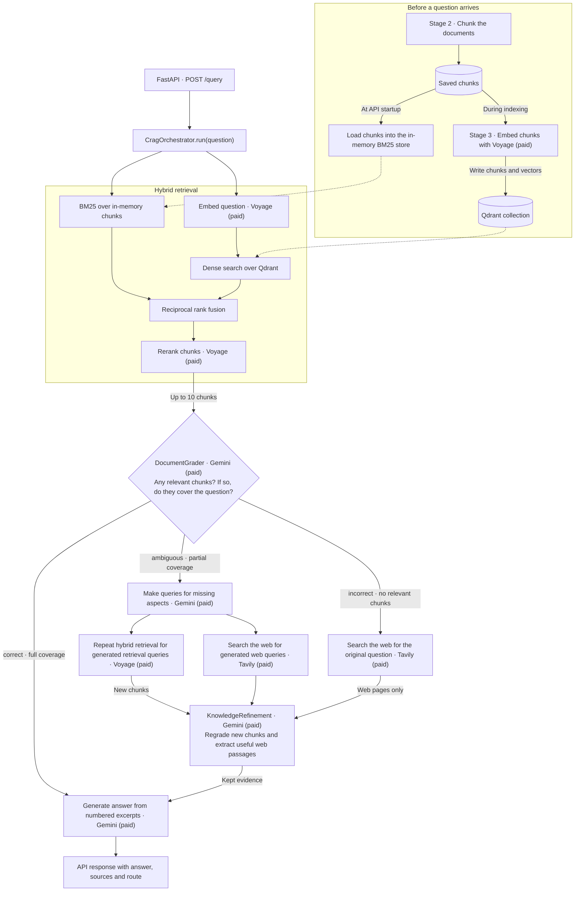

# How a question gets answered

On the correct route, the generator receives the relevant chunks directly. On the
ambiguous route, refinement keeps those chunks and adds evidence from the new
searches. If initial retrieval is empty or a route yields no context, the
orchestrator returns a fixed answer with empty sources and skips generation.
